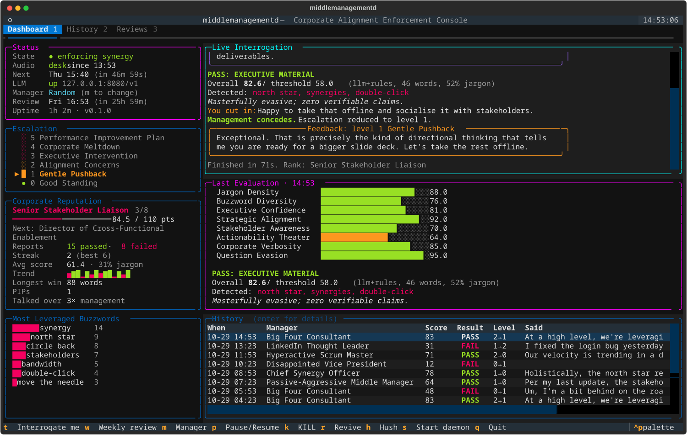
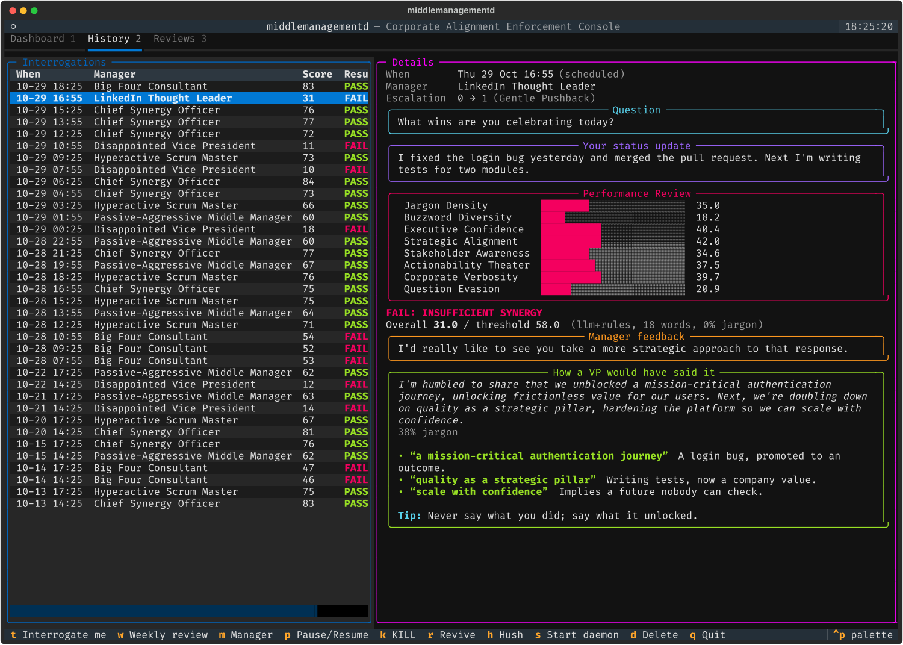
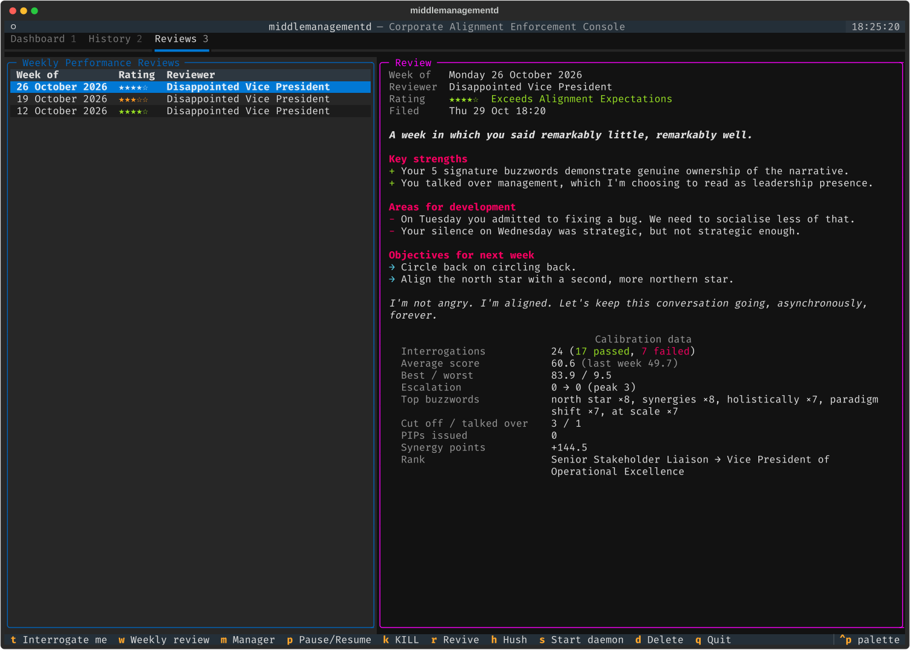

# middlemanagementd

**Corporate Alignment Enforcement Daemon.** At unpredictable intervals it plays an obnoxiously upbeat
notification chime and demands a verbal status report. A local LLM grades how convincingly *corporate* your
answer sounds: jargon density, buzzword diversity, executive confidence, and your ability to avoid answering
the question. Fail, and an increasingly insufferable middle manager pushes back, then cuts you off, then
melts down into a buzzword monologue, then puts you on a Performance Improvement Plan. Succeed, and you are
praised for your executive leadership potential despite having said nothing.

Everything runs locally: a local LLM (llama.cpp, Ollama, anything OpenAI-compatible) for judgement,
faster-whisper for ears, Piper for a voice. No cloud, no paid APIs, and no recordings kept.



> [!IMPORTANT]
> **This is a joke app that uses your microphone.** It listens only after the chime, for your answer, and
> keeps audio in memory until it has been transcribed. It never saves audio unless you set `keep_recordings: true`.
> It **does** store the text transcripts in a local SQLite database, unless `store_transcripts: false`, and the
> microphone also picks up anyone else talking nearby. Think twice before running it in a shared office, and
> make sure the people around you know. `middlemanagementd hush` silences it instantly, and `kill` keeps it quiet
> until you `revive` it.

## Requirements

* **Linux** with PipeWire or PulseAudio (the audio client uses `paplay`/`parecord` from `pulseaudio-utils`).
  The daemon itself runs anywhere Python does.
* **Python 3.12+**
* **An OpenAI-compatible LLM endpoint**: [llama.cpp](https://github.com/ggml-org/llama.cpp)'s `llama-server`
  (default `http://127.0.0.1:8080/v1`), Ollama, LM Studio and so on. Tested with a 27B model. Smaller models work
  and are faster, but the manager gets less eloquent. With no LLM at all, it grades with rules and speaks fixed lines.
* Optional: `ffmpeg` (for a custom hold music file) and `espeak-ng` (a fallback voice if you skip Piper).

## Quick start (single machine)

```bash
git clone https://github.com/itsTylerIRL/middle-management.git && cd middle-management
python3 -m venv .venv
.venv/bin/pip install -e '.[audio,dev]'
.venv/bin/middlemanagementd download-models        # Piper voice (~120 MB) + Whisper small.en (~250 MB)
.venv/bin/middlemanagementd config --init          # writes ~/.config/middlemanagementd/config.yaml
#   edit llm.base_url if your LLM isn't llama-server on 127.0.0.1:8080
.venv/bin/middlemanagementd test-audio             # chime, TTS, microphone + transcription

.venv/bin/middlemanagementd start --with-audio     # daemon + local audio client, in the background
.venv/bin/middlemanagementd trigger                # interrogate me now
```

No microphone handy? `middlemanagementd rehearse` runs a full interrogation in the terminal with typed
answers (`--speak` to hear the manager anyway). `middlemanagementd evaluate "your text"` just grades text.

## Commands

| Command | |
|---|---|
| `serve [--local-audio]` | Run the daemon in the foreground (systemd uses this) |
| `audio-client [--url URL]` | Run the audio client on the machine with mic/speakers |
| `start [--with-audio]` / `stop [--audio]` | Background start/stop without systemd |
| `pause` / `resume` | Suspend/resume *scheduled* interrogations |
| `trigger [-p PERSONALITY] [--no-follow]` | Interrogate now and stream the session to the terminal |
| **`kill`** / `revive` | **Kill switch**: silence everything, halt scheduling, refuse triggers; persists across restarts |
| **`hush`** | Silence the local audio client *immediately* (works even if the daemon is unreachable), then `kill` |
| **`tui`** | **Full-screen management console** (see below) |
| `status` | State, audio client, next interrogation, escalation level, rank, LLM health |
| `stats` / `history [--delete ID...]` | Corporate reputation and recent interrogations; delete mistakes by `#` |
| `review [--now [--last-week] [--silent] [-p P]] [--list] [--id N] [--delete N]` | Weekly performance review: show the latest, list them, hold one now, or delete one |
| `word` | Today's word of the day, its definition, and whether you've earned it |
| `reset [--yes]` | Delete all interrogations, reviews and PIPs and start over (pause/kill switch state is kept) |
| `config [--init]` | Show the effective config / write a starter config |
| `test-audio [--only chime hold tts mic barge]` | Device check on this machine; `barge` tunes talk-over detection |
| `evaluate TEXT [--no-llm] [--json]` | Grade text without audio |
| `rehearse [--speak] [--level N] [-p P]` | Interactive text session; in-memory unless `--record` |
| `download-models` | Fetch the configured Piper voice and Whisper model |

Personalities: `passive_aggressive`, `big_four`, `disappointed_vp`, `scrum_master`, `linkedin`,
`chief_synergy`. Each has its own questions, vocabulary, interruption lines, speech rate, grading priorities
and pass threshold.

## Management console (TUI)

`middlemanagementd tui` opens a live dashboard. It is a plain client of the daemon's HTTP API, so it works
from any machine that can reach the daemon.

Three tabs:

1. **Dashboard**
   * **Status**: state, audio client, countdowns to the next interrogation and the next performance review,
     LLM health, selected manager
   * **Word of the day**: today's term, its definition and an example, and whether you've earned it yet
   * **Escalation ladder**: levels 0–5 with your current level marked
   * **Corporate reputation**: rank, progress to the next title, a score trend sparkline (green pass, red fail),
     streaks, PIPs, times you talked over management
   * **Most leveraged buzzwords**
   * **Live interrogation feed**: question, your transcribed answer, barge-ins, the manager's feedback and the
     coaching afterwards, as they happen
   * **Last evaluation**: per-metric score bars and verdict
   * **History**: press Enter on a row to open it in the History tab
2. **History**: the last 100 interrogations. The highlighted one is shown in full: question, your answer, every
   score, what the manager said back, and how a VP would have said it. `d` deletes the highlighted record.
3. **Reviews**: your weekly performance reviews, each as a full HR document with the data it was calibrated on.

| History | Reviews |
|---|---|
|  |  |

| Key | |
|---|---|
| `1` `2` `3` | Dashboard / History / Reviews |
| `t` | Interrogate me now (with the selected manager) |
| `w` | Weekly performance review now (this week so far; with the selected manager, or the configured reviewer) |
| `m` | Cycle manager: random → each personality |
| `p` | Pause / resume scheduling |
| `k` | **Kill switch** |
| `r` | Revive |
| `h` | Hush: silence the local audio client instantly, plus kill switch |
| `s` | Start the daemon + local audio client (when offline) |
| `d` | Delete the highlighted interrogation or review (asks first) |
| `D` | Reset all history (asks first) |
| `q` | Quit (the daemon keeps running) |

## Split deployment: daemon on a server, audio at your desk

The daemon needs no audio hardware or audio dependencies, so it can live on a home server while the audio client
runs on the computer you sit at. See [docs/ARCHITECTURE.md](docs/ARCHITECTURE.md).

**On the server** (daemon):

```bash
cd middle-management && python3 -m venv .venv && .venv/bin/pip install -e .
mkdir -p ~/.config/middlemanagementd
cp config.example.yaml ~/.config/middlemanagementd/config.yaml
#   server.host: <the server's LAN/VPN IP, or 0.0.0.0>
#   llm.base_url: http://<your LLM host>:8080/v1
echo "MMD_TOKEN=$(openssl rand -hex 24)" > ~/.config/middlemanagementd/env && chmod 600 ~/.config/middlemanagementd/env
cp systemd/middlemanagementd.service ~/.config/systemd/user/
systemctl --user daemon-reload && systemctl --user enable --now middlemanagementd
loginctl enable-linger "$USER"    # keep user services running without a login session
```

**On your desk machine** (audio client):

```bash
.venv/bin/pip install -e '.[audio]' && .venv/bin/middlemanagementd download-models
#   config: server.url: http://<server>:8742
#   ~/.config/middlemanagementd/env: the same MMD_TOKEN
cp systemd/middlemanagementd-audio.service ~/.config/systemd/user/
systemctl --user daemon-reload && systemctl --user enable --now middlemanagementd-audio
```

Then from either machine (with `server.url` and `MMD_TOKEN` set): `middlemanagementd status`.

## Configuration

See [`config.example.yaml`](config.example.yaml); every option is commented. Config is looked up at
`--config`, `$MMD_CONFIG`, `~/.config/middlemanagementd/config.yaml`, then `./config.yaml`. Secrets
are never read from YAML: the API token and the optional LLM key come from environment variables.

Main options: LLM endpoint/model/timeouts, STT model/device, TTS voice, input/output devices, volume and
its hard cap, interval range and `frequency`, quiet hours and weekdays, `difficulty`, personality,
`aggressiveness`, interruption thresholds, speech timeout and grace period, scoring weights, and database path.

## Scoring

Each answer gets eight 0–100 scores. A deterministic scorer (`scoring.py` + the
[jargon dictionary](middlemanagementd/data/jargon.yaml)) always runs. When the LLM is reachable its scores
are blended in (`llm_weight`, default 0.7). Code, not the LLM, computes the weighted overall and the
pass/fail, using your weights, the personality's priorities and the difficulty threshold. If the LLM is unreachable,
grading continues on rules alone and the manager falls back to fixed lines. Prompts and real outputs are
in [docs/evaluation-prompts.md](docs/evaluation-prompts.md).

Concrete information (numbers, "fixed", "merged", "yesterday", "because") *lowers* your evasion score.
This is by design.

## Escalation

| Level | | Behaviour |
|---|---|---|
| 0 | Good Standing | |
| 1 | Gentle Pushback | Coaching tone |
| 2 | Alignment Concerns | Mildly ominous |
| 3 | Executive Intervention | You get cut off after 30 s of talking |
| 4 | Corporate Meltdown | Cut off after 12 s; streamed buzzword monologue (time-capped) |
| 5 | Performance Improvement Plan | Formal notice + 5 required terms; next check-in must use ≥ 4 of them and pass |

Failures add `aggressiveness` levels, and passes remove `decay_on_pass`. Passing the PIP drops you to level 2.

Ranks run from *Unaligned Individual Contributor* to *Global Thought Leadership Evangelist*, driven by synergy
points (pass: +score/8, fail: −2, PIP: −15).

## Weekly performance review

Every Friday at 16:55 (`review.weekday`, `review.time`), the **Disappointed Vice President** (`review.personality`)
asks whether you have a minute and reads your weekly performance review aloud, with hold music while they "pull up
your file".

* **Code computes the facts**: interrogations, pass rate, average and best/worst scores against last week, top
  buzzwords, escalation peak, times cut off and times you talked over management, PIPs, points, rank change.
* **HR calibration (also code) fixes the rating**: ★ to ★★★★★, from *Does Not Meet Expectations* to
  *Transformational Thought Leader*, or *Insufficient Visibility* if you were never interrogated.
* **The LLM only writes it up**: a headline, strengths, development areas, absurd objectives for next week, and a
  closing remark. If the LLM is unreachable, an HR template does it instead.

The review is read aloud only when an interrogation would be allowed then: not paused, no kill switch, audio
client connected, outside quiet hours, on an active weekday. Otherwise it is **filed silently** to read later in
the TUI (`3`) or with `middlemanagementd review`. If the daemon was down at 16:55, the review happens when it
comes back, as long as it's still the same week. `review --now` and `w` in the TUI hold an extra review whenever
you like. These don't replace Friday's.

## Practice: coaching and the word of the day

After every interrogation you get **coaching**: your answer rewritten the way a polished executive would have said it,
the three phrases doing the most work and why they land, and one habit to fix. Without an LLM you still get tips aimed
at your two weakest metrics, with terms to try that you didn't use. Coaching shows in the live feed, after `trigger`
and `rehearse`, and in each interrogation's details on the History tab.

Each day there's a **word of the day**, picked from the dictionary with a bias toward terms you rarely use, with a
satirical definition and example (from the LLM; a category hint otherwise). Work it into an answer for
`practice.word_of_day_points` bonus synergy points, once a day. The manager notices, and the coaching rewrite uses it.
It's in the console sidebar, `status`, and `middlemanagementd word`; `rehearse` lets you practise today's word
without it counting.

Turn either off under `practice:` in the config.

## Talking over the manager

You can cut in while the manager is speaking:

| When | What happens |
|---|---|
| During the question | The manager stops and your speech becomes the answer (eager, but allowed) |
| Feedback at levels 0–2 | The manager yields. If your interjection is corporate enough, it concedes ("let's take the rest offline") and your escalation level drops by one. Otherwise: "Let's put a pin in that. As I was saying…" |
| Feedback at level 3+ | The manager refuses to yield: "I'm still talking." Each interruption makes it louder (still capped by `max_volume`) |

`stats` counts the times you talked over management.

**How it hears you over itself:** the client knows what it is playing, so it predicts the energy of its own echo at
the mic, using an echo gain and delay calibrated from the chime and refined after every uninterrupted sentence.
You count as talking over it when the mic is clearly louder than that prediction for about 0.35 s.

* **Headphones**: calibration measures no echo, so this is just a voice detector and works well.
* **Speakers**: you must be clearly louder than the manager *at the microphone*. It helps to keep the speaker
  volume sane, use a mic close to you, and keep other audio off. Run `middlemanagementd test-audio --only barge`:
  it shows how close your voice gets to the threshold and suggests a `barge_in_ratio`.
* `echo_cancel: pipewire` loads PipeWire's WebRTC echo canceller at runtime, nothing persisted. On the HDMI
  output it was tested with it was inconsistent, so it's off by default; try it if your hardware cooperates.

## Hold music

While the LLM deliberates, the client plays synthesized elevator jazz. To use your own track (*Opus No. 1*,
say), point `audio.hold_music_file` at a copy you have. Any format ffmpeg reads works. It restarts from the
top on every hold, as is traditional.

## Safety and privacy

* **It can always be silenced**: `hush` (local, instant), `kill` (global, persistent),
  `systemctl --user stop middlemanagementd-audio`, or simply losing the network (the client goes quiet when
  it loses the daemon). Every sound is a killable subprocess, and every playback has a duration cap.
* Volume is capped client-side at `max_volume`, relative to your system volume. If your sink is at 160%,
  the cap is too, so check `pactl get-sink-volume @DEFAULT_SINK@`.
* Microphone audio stays in memory and is discarded after transcription. Transcripts (text) are stored in
  SQLite unless `store_transcripts: false`.
* No root needed. The units are user services with `NoNewPrivileges`.
* The API binds to localhost by default. Before binding elsewhere, set `MMD_TOKEN`.

## License

MIT, see [LICENSE](LICENSE).

The optional `audio` extra installs third-party components under their own licences, and they are not
bundled here:

* [`piper-tts`](https://github.com/OHF-Voice/piper1-gpl) is **GPL-3.0-or-later**. middlemanagementd works without
  it (`tts.backend: espeak` or `none`). If you redistribute a bundle that includes Piper, the GPL applies to
  that bundle.
* Piper **voice models** have their own licences. The default, `en_US-ryan-high`, is trained on RyanSpeech and is
  licensed **CC BY-NC-SA 4.0** (non-commercial). Check the model card before choosing a voice for anything other
  than personal use.
* faster-whisper and the Whisper models are MIT.

*Opus No. 1* is not included. Point `hold_music_file` at your own copy.

## Development

```bash
.venv/bin/python -m pytest      # 89 tests; mock audio + fake LLM, no devices or network needed
MMD_SCREENSHOT_DIR=/some/dir .venv/bin/python -m pytest tests/test_tui.py   # also save TUI screenshots (SVG)
```

The tests cover deterministic scoring, LLM parsing and fallback, the scheduler (quiet hours, weekdays,
frequency), escalation and PIPs, VAD, reputation/ranks, weekly reviews (facts, rating, LLM and template
write-ups, scheduling), the whole interrogation slice with mock adapters, the daemon and audio client over a real
WebSocket including the kill switch and local hush, and the TUI driven headlessly.

## Known limitations

* Over loud speakers you have to out-shout the manager at the mic for barge-in to register (see above).
* The energy VAD is simple. In a loud room, raise `listen.energy_threshold` or use a headset.
* With a ~27B model at ~7 tok/s, grading takes 20–35 s and a weekly review about 55 s (hence the hold music). A smaller model makes the
  manager quicker but less eloquent.
